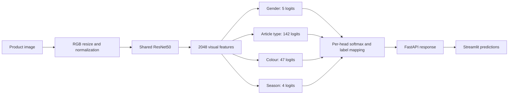
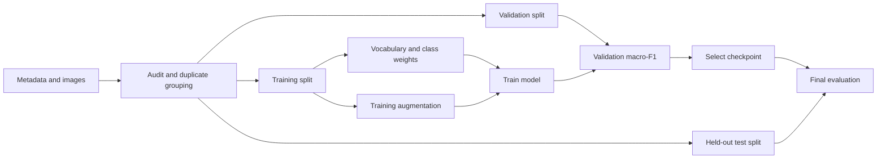

# Understand the architecture

The class counts above come from the actual prepared public dataset. They are not
hard-coded into the model: `labels.json` determines each head's dimensions and index
ordering. Synthetic or custom datasets can have different class counts.

Training consumes logits directly, because cross-entropy includes log-softmax.
Inference applies softmax to expose the highest-probability class and confidence.

The initial CPU workflow freezes ResNet50 and updates only the heads. Batch
normalization in the frozen backbone remains in evaluation mode. A later fine-tuning
run can initialize from that checkpoint, unfreeze the backbone, and start a fresh
optimizer at a smaller learning rate. Initialization does not restore optimizer state.

Relevant code: `data.py` prepares inputs, `model.py` defines the shared network,
`losses.py` defines objectives, `train.py` selects checkpoints, `evaluate.py` computes
held-out metrics, and `inference.py` restores the model for both benchmark and API use.
