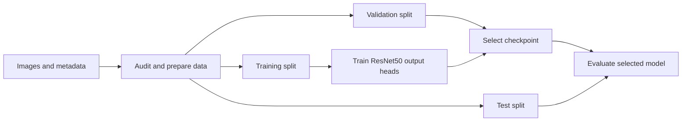

# Complete Project Interview Coaching

## Multi-Task Fashion Image Classification

Project repository: https://github.com/csmax729/multi-label-fashion-classification

Prepared on 13 October 2026. This guide contains the complete interview coaching
answer, including the project walkthrough, four speaking versions, practice
questions, and communication exercises.

Your project takes **one fashion product image and predicts four attributes: gender
category, article type, base colour, and season**. We explain it using the code and
results that actually exist.

The implementation created in this conversation was AI-assisted. When discussing
your contribution, distinguish the requirements you provided, work you personally
perform, and code you are still learning.

## 1. Understand your project in simple English

Imagine an online fashion catalogue containing thousands of product photos. Each
product needs labels such as "T-shirt," "Blue," and "Summer." This project explores
how a trained image model can predict those labels.

For illustration, a product photo could produce:

| Attribute | Example prediction |
|---|---|
| Gender category | Women |
| Article type | Tshirts |
| Base colour | Blue |
| Season | Summer |

These are predictions based on the dataset's annotations. Season and gender
category are not always clear from appearance alone.

A possible user is a catalogue or product-tagging team. The current application
demonstrates image upload and prediction; it does not automatically update a
retailer's catalogue.

Remember this basic explanation:

> "The user uploads a product image. The model analyses it and returns four predicted attributes."

The project's main challenges are class imbalance, imperfect labels, duplicate
images, reliable evaluation, and efficient inference.

## 2. Understand the technologies and their roles

| Technology | What it does in this project |
|---|---|
| Python | Implements the pipeline and application. |
| PyTorch | Builds and trains the neural network. |
| torchvision | Supplies pretrained ResNet50 and image transformations. |
| Pillow | Opens and processes images. |
| Python CSV and collections utilities | Read metadata and calculate class counts. |
| Matplotlib | Creates the EDA distribution plots. |
| NumPy | Supports reproducibility and timing calculations. |
| FastAPI and Uvicorn | Run the HTTP prediction service. |
| Streamlit | Provide the image-upload interface. |
| Requests | Connect Streamlit and benchmark clients to the API. |
| pytest | Tests data preparation, losses, evaluation, API, UI, and experiments. |
| uv and uv.lock | Install reproducible dependencies. |
| Docker | Package the inference application in a tested local container. |

A simple way to remember the main technologies is:

> "PyTorch handles the model, FastAPI handles prediction requests, and Streamlit handles the interface."

## 3. Understand the complete workflow

The system has a **training workflow** and a **prediction workflow**.



During training:

1. Download the public fashion dataset.
2. Read the product metadata and locate matching images.
3. Check missing labels, missing images, malformed rows, and duplicates.
4. Keep duplicate image content together when splitting the dataset.
5. Create training, validation, and test manifests.
6. Learn class mappings and class weights from training data.
7. Apply training augmentation.
8. Train the output heads.
9. Select a checkpoint using validation macro-F1.
10. Evaluate the selected checkpoint on held-out test data.

The real dataset preparation produced:

| Split | Images |
|---|---:|
| Training | 31,106 |
| Validation | 6,657 |
| Test | 6,657 |
| Total usable | **44,420** |

**Training data teaches the model. Validation data guides model selection. Test
data measures the selected model's held-out performance.**

The prediction workflow is:


Behind the scenes, an uploaded image is decoded, converted to RGB, resized,
normalized, and converted into a tensor. The model produces class scores. Softmax
converts those scores into probabilities, and the highest-scoring class is mapped
to its label.

FastAPI loads the model once at startup **per server process** and reuses it across
requests. It does not reload the checkpoint for every image.

## 4. Understand the model without complicated language

ResNet50 is the shared visual feature extractor.

Think of it as producing a **visual summary** of the image. Four separate
classifiers use that summary to answer four different questions.

The actual model code follows this pattern:

```python
features = self.backbone(images)
return {task: self.heads[task](features) for task in TASKS}
```

The first line extracts shared features. The second line sends those features
through each task's classification head.

For the prepared public dataset:

| Head | Number of classes |
|---|---:|
| Gender category | 5 |
| Article type | 142 |
| Base colour | 47 |
| Season | 4 |

These counts come from the dataset's label vocabulary; they are not fixed numbers
built into the architecture.

The shared feature vector contains 2,048 values. Each head learns how to map those
features to its own classes.

The precise description is **multi-task, multi-output classification**. Each task
selects one category. For that reason, the project uses softmax and categorical
losses rather than independent sigmoid outputs.

A short technical explanation is:

> "A shared ResNet50 extracts image features, and four separate heads predict four categorical attributes."

### Pretraining and freezing

Pretraining means starting with ResNet50 weights that already learned useful
visual patterns from ImageNet.

Freezing means keeping the backbone's parameters fixed while learning the new
output heads.

The initial real-data run trained the four heads on a **frozen pretrained
backbone**. It did not fine-tune the entire ResNet50.

The implementation also keeps the frozen backbone's batch-normalization
statistics fixed. Otherwise, those statistics could change even when its
parameters are not being updated.

### Loss functions

A loss measures how wrong a prediction is and provides the signal used to update
the model.

| Loss | Simple explanation |
|---|---|
| Ordinary cross-entropy | The baseline categorical classification loss. |
| Weighted cross-entropy | Gives underrepresented training classes more influence. |
| Focal loss | Reduces the contribution of easy, confidently correct examples. |
| Label-smoothed cross-entropy | Spreads some target probability across other classes to discourage overconfidence. |

The three custom loss alternatives are **selectable choices**. They are not all
stacked together in the real training run.

The completed real-data run used weighted cross-entropy.

### Augmentation

Augmentation presents modified training views while keeping the original label.

The six implemented operators are:

- Random resized crop.
- Horizontal flip.
- Small rotation.
- Restrained colour jitter.
- Affine translation.
- Random erasing.

These are intended to encourage generalization. They do not create independent
products, and their real-data performance benefit still needs controlled
measurement.

Colour changes are restrained because aggressive colour augmentation could make
the original colour label incorrect.

## 5. Know the important files

| File | Responsibility |
|---|---|
| download.py | Downloads and verifies the public dataset. |
| data.py | Audits inputs, groups duplicates, splits data, and loads training images. |
| demo.py | Generates clearly labelled synthetic data for testing. |
| eda.py | Produces class counts, imbalance ratios, and distribution plots. |
| model.py | Defines shared ResNet50 and its four output heads. |
| losses.py | Implements the loss alternatives and multi-task objective. |
| train.py | Runs training and validation-based checkpoint selection. |
| evaluate.py | Calculates held-out metrics and confusion matrices. |
| inference.py | Loads checkpoints and performs predictions. |
| api.py | Implements /health and /predict. |
| ui.py | Implements the Streamlit interface. |
| benchmark.py | Measures decoding, preprocessing, and inference latency. |
| scripts/benchmark_api.py | Measures the warm HTTP prediction path. |
| scripts/run_experiments.py | Runs matched augmentation and loss comparisons. |
| tests/ | Checks important pipeline and application behaviour. |

Also understand three saved artifacts:

- **CSV manifests:** identify which images and labels belong to each split.
- **labels.json:** preserves the class-to-index ordering.
- **best.pt:** stores model weights, label mappings, configuration, and provenance.

Weights alone are insufficient: inference also needs the correct labels and
preprocessing.

## 6. Use the verified results

| Measurement | Recorded result |
|---|---:|
| Usable public-dataset examples | 44,420 |
| Validation mean task accuracy | 57.73% |
| Test mean task accuracy | 58.16% |
| Test mean task macro-F1 | 0.4427 |
| Test all-four exact match | 10.20% |
| Warm local HTTP median latency | About 27 ms |
| Warm local HTTP p95 latency | About 163 ms |
| Automated tests | 66 passed |

The initial model used one epoch, a frozen ImageNet-pretrained backbone, 96-pixel
inputs, and CPU training.

**Mean task accuracy** averages the four task accuracies. **Exact match** requires
all four labels to be correct for the same image.

The latency measurement used one real image, 30 sequential requests, and five
warmups. It excludes cold startup, concurrent traffic, public-network conditions,
and Streamlit rendering.

The original **82% accuracy and 15% improvement claims remain unverified**. The full
real-data ablation suite has not been run.

The dataset also has much greater overall imbalance than 3:1:

| Task | Largest/smallest class ratio |
|---|---:|
| Gender category | About 34:1 |
| Article type | 7,068:1 |
| Base colour | About 1,945:1 |
| Season | About 7.2:1 |

## 7. Practise these four speaking versions

The timings are approximate. Speak slowly and pause between ideas. The scripts
describe the project; add personal implementation claims only when they match
work you actually performed.

### A 30-second introduction

> "My project classifies fashion product images. It takes one image and predicts four attributes: gender category, article type, colour, and season. It uses a pretrained ResNet50 with four output heads. A Streamlit interface lets users upload images, while FastAPI runs the prediction service. The project also includes data auditing, training, evaluation, and latency measurement."

### A one-minute explanation

> "My project explores automatic tagging of fashion product images. Instead of predicting one label, it predicts four attributes: gender category, article type, base colour, and season.
>
> The pipeline uses a public dataset with more than forty-four thousand usable examples. Before training, it checks missing labels, missing images, and duplicate image content. Duplicate images stay together when creating training, validation, and test splits.
>
> The model uses an ImageNet-pretrained ResNet50 as a shared feature extractor, followed by four classification heads. The code includes augmentation and three alternative custom losses.
>
> Streamlit provides the upload interface, and FastAPI returns predictions. The initial one-epoch model achieved about 57.7 percent average validation accuracy. It is a working baseline, with further training and controlled comparisons still needed."

### A two-minute explanation

> "My project is a fashion image classifier that predicts four attributes from one product image: gender category, article type, base colour, and season. A possible use is helping catalogue teams tag product photos.
>
> The first stage prepares the public dataset. It connects metadata rows to image files and checks whether the images and labels are usable. The audit produced 44,420 usable examples. It also identified duplicate image content and substantial class imbalance.
>
> The data is divided into training, validation, and test splits. Duplicate images are kept in the same split to reduce leakage. Class mappings and class weights come from training data.
>
> The model uses pretrained ResNet50 to extract shared visual features. Four separate output heads then predict the four attributes. Sharing the backbone allows the system to make all four predictions in one forward pass.
>
> The initial training run freezes the backbone and trains the new heads. The project includes six augmentation operators and three selectable custom loss alternatives. Weighted cross-entropy was used for the completed real-data run.
>
> Evaluation reports per-task accuracy, macro-F1, and exact match. The initial test mean task accuracy was 58.2 percent, while all-four exact match was 10.2 percent. These metrics describe different levels of success.
>
> For inference, Streamlit accepts an image and sends it to FastAPI. The API validates the upload, preprocesses it, runs the loaded model, and returns labels and confidence scores.
>
> Future work includes improving colour classification, fine-tuning the backbone, and running controlled real-data experiments."

### A five-minute technical explanation

> "My project explores automatic classification of fashion product images. The input is one product photo, and the output contains four attributes: gender category, article type, base colour, and season. A possible application is assisting catalogue teams with product tagging. The implementation includes data preparation, model training, evaluation, and an image-upload application.
>
> The data comes from the public Fashion Product Images dataset. Its metadata links product IDs to attributes and image files. The preparation stage checks missing labels, missing images, malformed CSV rows, and duplicate image content. The real audit started with 44,446 metadata rows and produced 44,420 usable examples. It excluded twenty-one rows with missing task labels and five with missing images. It also repaired twenty-two display-name rows containing unquoted commas.
>
> Duplicate handling is important because the same image appearing in both training and evaluation could inflate performance. The implementation hashes decoded RGB image content and keeps matching images together during splitting. It creates approximately seventy percent training data, fifteen percent validation data, and fifteen percent test data. The actual split sizes are 31,106, 6,657, and 6,657.
>
> The model uses ImageNet-pretrained ResNet50 as a shared backbone. Its original classifier is replaced, leaving a 2,048-value visual feature vector. Four linear heads use those shared features. The prepared dataset has five gender classes, 142 article types, forty-seven colours, and four seasons. Each head predicts one category, so the model uses categorical losses and softmax predictions.
>
> The initial training run freezes the backbone and updates the four heads. The frozen backbone's batch-normalization statistics also remain fixed. This provides a practical transfer-learning baseline on the available CPU machine. The run uses ninety-six-pixel inputs, a batch size of sixty-four, and channels-last memory storage to improve convolution throughput.
>
> Training augmentation includes random crops, horizontal flips, small rotations, restrained colour changes, translations, and random erasing. These transformations are applied to training data. Validation and inference use deterministic preprocessing. Colour changes are kept modest because the project must also predict colour.
>
> The implementation provides weighted cross-entropy, focal loss, and label-smoothed cross-entropy as alternatives. Weighted cross-entropy increases the influence of underrepresented classes. Focal loss reduces the contribution of easy examples. Label smoothing discourages excessive confidence. The completed real-data run used weighted cross-entropy, with class weights calculated from training counts.
>
> Validation macro-F1 selects the checkpoint. Evaluation then reports per-task accuracy, class support, confusion matrices, macro-F1, and exact match. The initial one-epoch model achieved 57.73 percent validation mean task accuracy and 58.16 percent test mean task accuracy. Test exact match was 10.20 percent. Colour classification was the weakest task, making it a clear area for further investigation.
>
> The application uses Streamlit for image upload and FastAPI for inference. FastAPI loads one predictor at startup, validates each upload, preprocesses the image, and reuses the loaded model. It returns four labels, confidence scores, and prediction timing. Confidence is not a calibrated guarantee of correctness.
>
> Warm local HTTP testing measured approximately twenty-seven milliseconds median latency and 163 milliseconds p95. That measurement covers sequential requests under the recorded conditions, not cold starts or concurrent production traffic.
>
> The initial implementation was created with AI assistance. Personal contribution should be described through work actually completed, such as reviewing modules, reproducing experiments, changing code, or testing behaviour. The main future steps are further head training, backbone fine-tuning, controlled loss comparisons, stronger robustness evaluation, and public deployment."

## 8. Follow this speaking structure

You do not need every point for every answer. Use the full structure when an
interviewer asks for a detailed explanation.

| Order | What to explain | Memory cue |
|---|---|---|
| 1 | Project introduction | One image, four attributes |
| 2 | Problem statement | Product tagging |
| 3 | Objective | Predict useful catalogue labels |
| 4 | Technologies and rationale | Model, API, interface |
| 5 | Workflow | Prepare, train, evaluate, predict |
| 6 | Personal contribution | Work you can demonstrate |
| 7 | Challenges and solutions | Imbalance, leakage, compute |
| 8 | Results and future scope | Verified baseline and next experiments |

For a short answer, remember only:

> **Purpose → workflow → result.**

For a technical answer, remember:

> **Data → model → training → evaluation → serving.**

## 9. Explain your contribution honestly

For the work completed in this conversation, a supported description is:

> "I provided the project requirements and selected the public dataset. The initial implementation was created with AI assistance. My next responsibility is to understand the modules, reproduce the workflow independently, and verify the design decisions."

As you complete work yourself, replace that final sentence with specific evidence.

| After personally doing this | You can accurately say |
|---|---|
| Running the demo and checking outputs | "I reproduced the complete demo workflow and inspected its outputs." |
| Tracing and explaining model.py | "I reviewed the shared-backbone architecture and verified the four output heads." |
| Changing code and testing it | "I modified this component and checked the resulting behaviour." |
| Running matched experiments | "I compared these configurations using the same split and training settings." |

Understanding a component is valuable, but it is different from implementing or
experimentally validating it.

## 10. Prepare for technical interview questions

These are practice questions and sample answers. During a live mock interview,
take them one at a time.

### "Why did you choose this project?"

A possible answer, if it matches your motivation:

> "I wanted to explore computer vision through a practical product-tagging problem. The project combines data preparation, deep learning, evaluation, and application development."

### "What problem does it solve?"

> "It explores automatic prediction of product attributes from fashion images, which could support catalogue tagging."

### "Why use ResNet50?"

> "Pretrained ResNet50 provides useful visual features and a well-understood transfer-learning baseline. It lets the project start from learned features instead of training the entire network from scratch."

### "Why four heads rather than four separate models?"

> "The attributes can use shared visual features. One backbone extracts those features, and separate heads make task-specific predictions in one forward pass."

### "Is this multi-label classification?"

> "It is more precisely four multi-class tasks for one image. Each head selects one mutually exclusive category, so the implementation uses softmax and categorical losses."

### "What are residual connections?"

> "They provide shortcuts around network blocks. The block output is combined with the shortcut, which helps gradients pass through a deep network during training."

### "How did you handle class imbalance?"

> "The pipeline measures class distributions and calculates weights from training counts. The completed run uses weighted cross-entropy. Focal loss and label smoothing are available for controlled comparisons."

### "How did you prevent data leakage?"

> "Images with identical decoded pixel content stay in the same split. Class mappings and weights come from training data. Validation selects the checkpoint, and test data is used for held-out evaluation."

### "Does duplicate hashing find every related image?"

> "It finds exact decoded-image duplicates. It does not detect every near duplicate or related product family, so those remain limitations."

### "Why report macro-F1?"

> "Accuracy can hide poor performance on rare classes. Macro-F1 treats classes equally within each task, then the project averages the four task scores."

### "What does 58.2 percent test accuracy mean?"

> "It is the mean of the four task accuracies. It does not mean all four predictions were correct for 58.2 percent of images. All-four exact match was 10.2 percent."

### "What happens when a user uploads an image?"

> "Streamlit sends it to FastAPI. The API validates and decodes the image, applies the model's preprocessing, runs the loaded predictor, maps class indices to labels, and returns the results."

### "Does the API cache predictions?"

> "It reuses the loaded model. It does not cache prediction results."

### "How did you measure latency?"

> "The recorded HTTP benchmark used one real image, five warmups, and thirty sequential requests. It measured about twenty-seven milliseconds median and 163 milliseconds p95 on the local CPU machine."

### "What was the biggest challenge?"

A project-supported example is:

> "The dataset has severe class imbalance, and the CPU training environment has limited compute. The implementation addresses imbalance with training-derived weights and makes CPU training more practical through smaller inputs and a tested memory-layout option."

Describe solving it personally only after you have reproduced or worked on that
part.

### "What would you improve?"

> "I would investigate colour errors, train the heads further, fine-tune the backbone, and compare losses under matched conditions. I would also evaluate near-duplicate leakage and performance on independent images."

### "Did you achieve the proposed fifteen percent improvement?"

> "That improvement has not been established. The experiment runner is implemented and tested, but the complete real-data comparison still needs to be run."

### "What did you learn?"

Use this after you can explain these ideas independently:

> "I learned why data quality, leakage prevention, and metric definitions matter as much as model architecture. I also learned how a saved model becomes a prediction service."

## 11. Handle nervousness and unexpected questions

Before answering, take a brief pause and choose the structure that fits the
question.

Useful opening phrases are:

- "Sure. The main purpose of the project is…"
- "Let me explain the workflow step by step."
- "The main role of this component is…"
- "There are three parts to the system…"

If you forget your next point:

> "Let me take a moment to organize my thoughts."

Then return to one anchor: **data, model, or application**.

If you do not know something:

> "I haven't tested that case yet. My current understanding is…"

Separate what you know from what you would investigate. A calm, precise boundary
is stronger than an invented answer.

Use short sentences. Give the main answer first, then add one reason or example.
You do not need to fill every pause.

An example English correction:

> "This project predict four label from image."

A natural version is:

> "This project predicts four labels from an image."

The technical idea was understandable; the correction simply improves the
sentence.

## 12. Practise understanding instead of memorization

Work through these exercises in order:

1. Explain the project's purpose without naming any technology.
2. Describe the four outputs without looking at notes.
3. Trace one uploaded image through Streamlit, FastAPI, and inference.
4. Explain the two lines in model.forward.
5. Explain why duplicate images stay in one split.
6. Explain the difference between mean task accuracy and exact match.
7. Describe one real limitation and a sensible next experiment.
8. Give the 30-second explanation, then expand it to one minute.

For code-based practice in the prepared environment:

```bash
source .venv/bin/activate
bash scripts/demo.sh
python -m pytest -q
```

Inspect the generated reports and connect each result to the command that
produced it. The demo uses synthetic images, so its scores demonstrate execution
rather than fashion accuracy.

For every practice answer, use this feedback method:

- Identify what was technically correct.
- Identify missing or unclear information.
- Correct any misunderstanding.
- Rewrite the answer in natural English.
- Reduce it to a short memory cue.
- Say it again in your own words.

For example, an answer such as:

> "It is a deep learning project that detects clothes."

Correctly identifies the general area, but "detects" suggests locating objects. A
clearer answer is:

> "The project classifies a product photo by predicting gender category, article type, colour, and season."

The memory cue is:

> **One product image → four predicted attributes.**

Your preparation should build from that simple explanation toward the actual
code, measured results, and work you can demonstrate independently.
